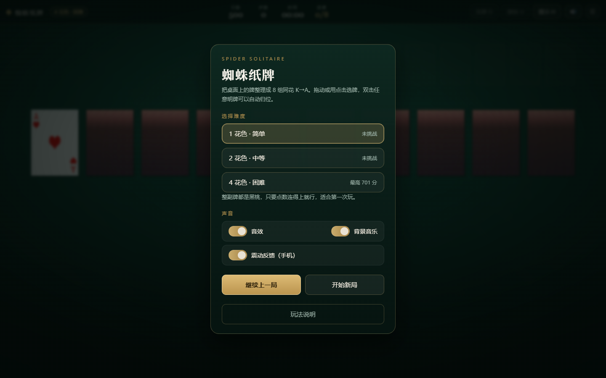
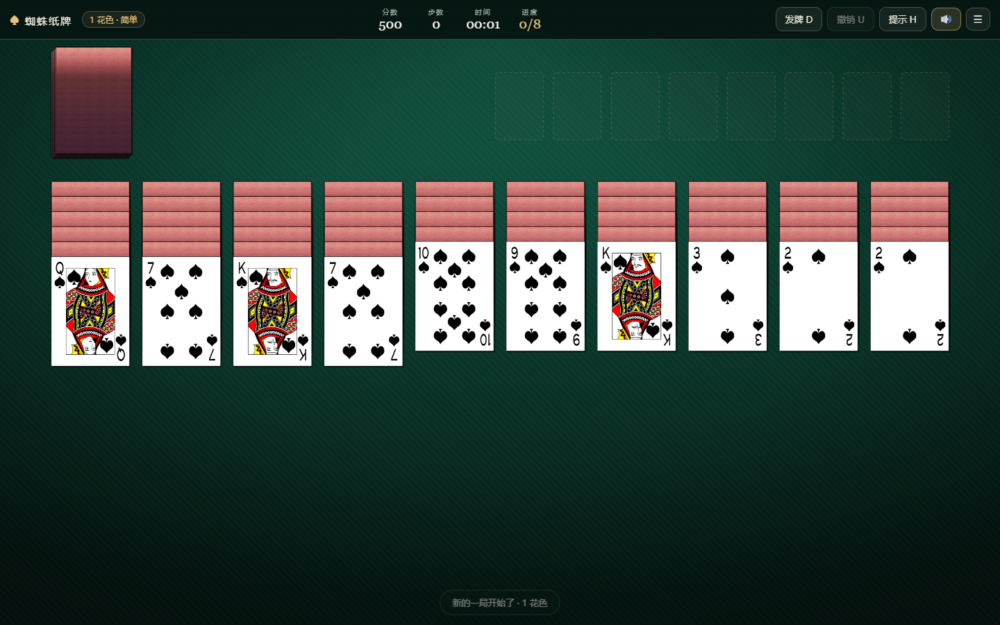
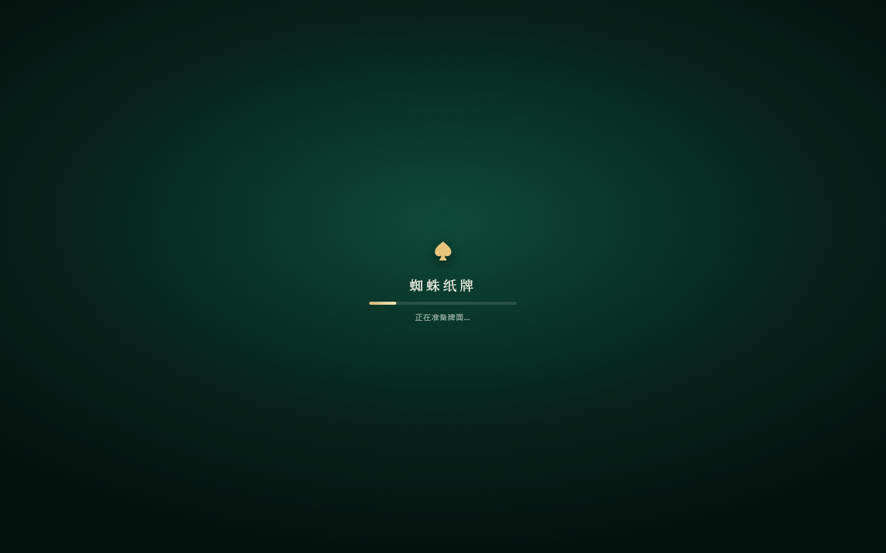
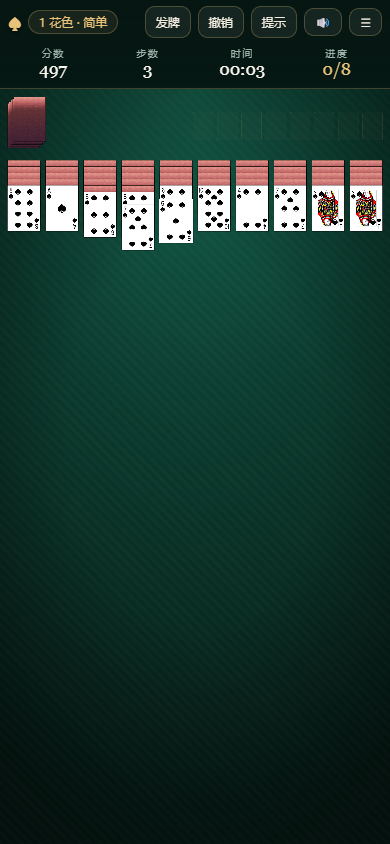
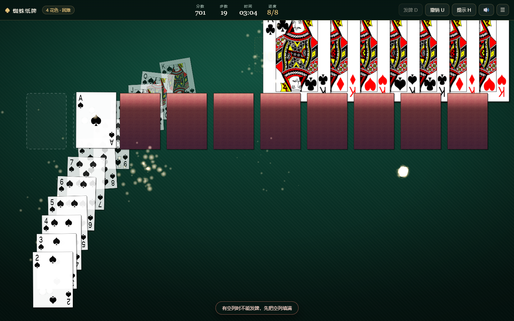
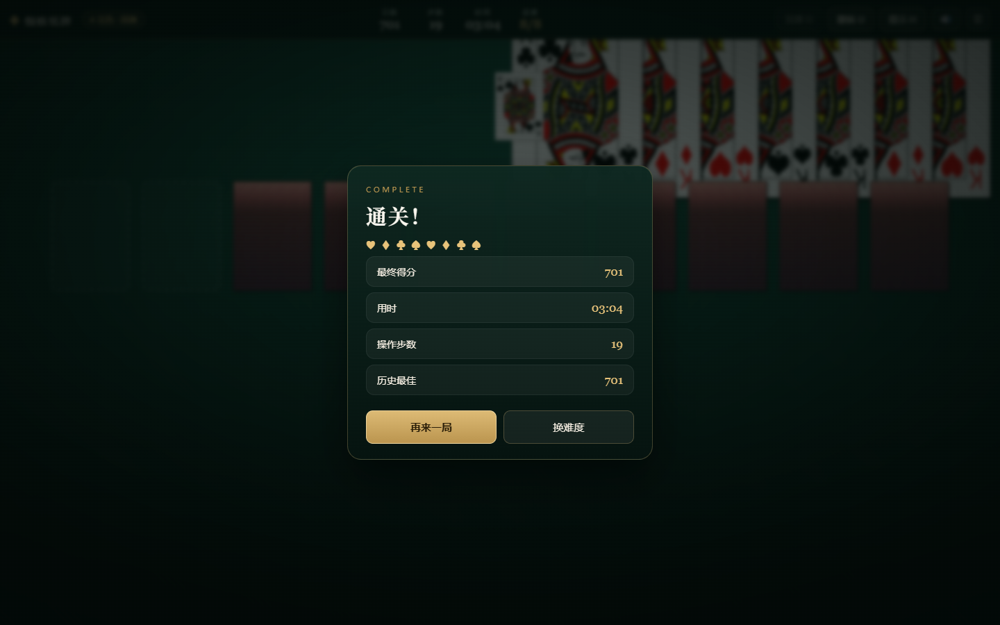
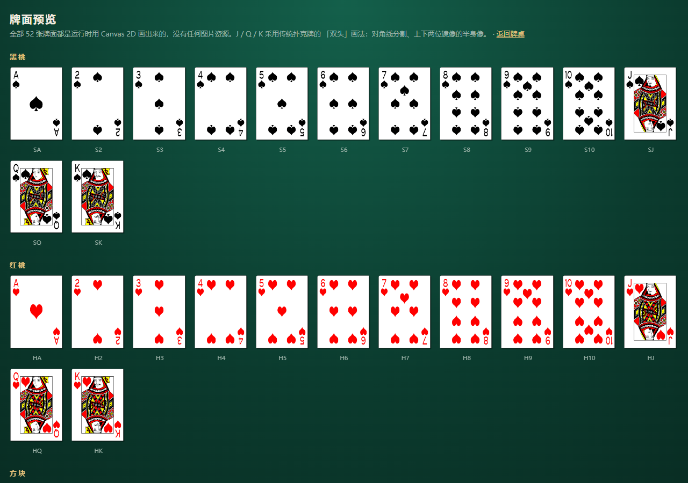

# 蜘蛛纸牌 · Spider Solitaire（H5）

一个手机上就能直接玩的蜘蛛纸牌：**Phaser 3 + TypeScript + Vite**，
三种难度、拖拽与点击双操作、撤销/提示/双击归位、完整音效与背景音乐（全部实时合成，不依赖任何音频文件）。
牌面使用现成的**标准扑克牌素材**（CC BY 3.0，见下），不是手绘的。

| 开局 | 牌桌 |
| --- | --- |
|  |  |

| 手机加载页 | 手机上玩（真实触摸事件） |
| --- | --- |
|  |  |

| 收牌瞬间 | 通关 |
| --- | --- |
|  |  |

| 手机竖屏 | |
| --- | --- |
|  | 竖屏时 10 列会整体缩到刚好放下，横屏视野更宽 |

> 上图由 `npm run playtest` 在真实 Chromium 中自动截取（见 `.playtest/shots/`）。

牌面（含传统 J / Q / K 人头牌）可以看这张全牌面图：



## 素材来源与授权

牌面不是画出来的，而是使用开放授权的标准扑克牌素材：

| 项目 | 内容 |
| --- | --- |
| 素材 | Playing Cards（Free Game Assets 08）中的 `Classic` 一套 + `Card-Back-04` 牌背 |
| 作者 | Ryan Dansie / Iron Star Media |
| 来源 | [OpenGameArt](https://opengameart.org/content/playing-cards-0) |
| 授权 | **CC BY 3.0**（需保留署名） |

处理方式（脚本：[tools/build-card-atlas.ps1](tools/build-card-atlas.ps1)）：

1. 从 768×1063 的原图等比缩放到 194×269；
2. 每张下方叠一层很淡的黑色投影，让牌在桌面上有立体感；
3. 拼成一张 **2600×1385、13 列 × 5 行**的图集 `public/assets/cards/atlas.png`（**442 KB**，52 张牌 + 牌背一次请求下完）。

署名信息同时写在 [public/assets/cards/ATTRIBUTION.txt](public/assets/cards/ATTRIBUTION.txt) 与游戏内的「玩法说明」面板里。
按 CC BY 3.0 的要求，**分发本项目时请保留这些署名**。

## 快速开始

```bash
npm install
npm run dev        # 开发：http://127.0.0.1:5173
npm run build      # 产物输出到 dist/（纯静态，丢到任何静态托管即可）
npm run preview    # 本地预览打包结果：http://127.0.0.1:4173
npm test           # 规则层单元测试（22 项）
npm run playtest   # 真实浏览器冒烟测试 + 截图（38 项）
```

`playtest` 需要先跑着 `npm run preview`（默认连 `http://127.0.0.1:4173/`，可传 URL 覆盖）。

想看牌面细节可以打开 **`/cards.html`**（全 52 张牌面 + 牌背预览页），或者用 `node tools/card-art-preview.mjs`
把任意一张牌输出成终端字符画。

## 设计说明

### 游戏幻想与玩家动作

主题是「安静下来的桌上经典」：深绿绒布、金线收边、象牙卡面。
玩家的四个动作是 **翻看、搬运、收顺、发牌**，全部围绕"把混乱变成秩序"的满足感。

| 项目 | 决策 |
| --- | --- |
| 难度 | 1 花色（简单）／2 花色（中等）／4 花色（困难），可随时换 |
| 牌局 | 104 张，10 列（前 4 列 6 张、后 6 列 5 张），5 轮发牌堆 |
| 移动 | 可整段搬动**同花色且连续递减**的明牌；落点必须比它大 1 点，花色不限 |
| 收牌 | 凑成同花 K→A 自动收走，**+100 分** |
| 计分 | 500 起，每次操作 −1，通关再按用时给奖励分 |
| 发牌限制 | 经典规则：有空列时不能发牌，界面会直接说明原因 |
| 提示 | 会评估「续同花 > 能翻暗牌 > 能空出列 > 普通接续」，给出当前最值得走的一步 |

### 操作方式

- **拖动**：抓住牌或整段同花顺拖到目标列（拖动时目标列会发光，合法为金色、非法为红色）。
- **点选**：点一张明牌选中（金色描边），再点目标列即可落牌；点空白处取消。
- **双击**：任意明牌双击自动归位到最合适的位置。
- **快捷键**：`空格`/`D` 发牌，`U`（或 `Ctrl+Z`）撤销，`H` 提示，`N` 菜单，`M` 静音，`Esc` 返回。

### 声音设计（Web Audio 实时合成）

没有任何音频素材文件，所有声音都是振荡器与噪声现场算出来的，首屏即可发声，体积为零：

| 事件 | 声音构成 |
| --- | --- |
| 拿牌 / 取消 | 高频噪声短扫 + 三角波点音 |
| 翻牌 | 带通噪声上扫（900→2800Hz）+ 极短方波"嗒" |
| 落牌 | 175Hz 正弦下滑 + 低频闷响，每张牌有轻微随机音高 |
| 发一轮 | 10 张牌依次落下的错落敲击，并按列做左右声像 |
| 非法操作 | 两个下行方波短促"嘟嘟" |
| 空列发牌 | 低音锯齿波 + 提示音 |
| 收一组 | C-E-G-C 三角波琶音 + 噪声闪光 + 低音垫 |
| 通关 | 上行七音琶音 + 大三和弦长音 + 低频轰鸣 + 闪光 |
| 撤销 | 反向气声扫频 |
| 背景音乐 | Am7–Fmaj7–Cmaj7–G6 循环，66 BPM，三角波和声垫 + 稀疏琴音 + 沙锤，音量刻意压得很低 |

- 浏览器要求用户手势后才能出声，所以音频在第一次点击/按键时自动解锁。
- 顶栏 🔊 一键静音全部声音；开局面板和菜单里可以分别开关音效与音乐。
- 切到后台标签页会自动 suspend，回来再恢复。

### 界面与响应式

- 顶栏（DOM）只放高频信息：**分数 / 步数 / 时间 / 进度** + 发牌、撤销、提示、声音、菜单。
- 牌桌（Canvas）承载全部玩法：牌堆、收牌位、10 列牌。
- 需要文字的面板（开局、菜单、玩法说明、通关）都在 DOM 里做，可读性与无障碍更好。
- 卡牌宽度由可视宽度算出，纵向叠放间距会根据**最长的一列自动压缩**，所以从 320px 小屏到 4K 桌面都不会出现牌被截断；窄竖屏第一次进入会提示可以横屏。

### 专为手机做的部分

- **首屏加载页**：进入页面立刻有加载条，不会白屏；牌面素材（442 KB）一次下完，加载失败会给出重试按钮。
- **触屏优先**：拖动是真正的触摸手势（不是模拟鼠标）；也支持「点一下选牌 → 点目标列」，手指够不到牌缝时更好用；
  双击任意明牌自动归位。拖动时页面不会跟着滚动（`touch-action: none` + `overscroll-behavior: none`）。
- **震动反馈**：走错一步、收掉一组、通关都会轻轻震一下（`navigator.vibrate`，iOS 会自动跳过），可在菜单里关掉。
- **省电**：手机宽度下粒子数量自动减少约一半。
- **可加到主屏**：带 `manifest.webmanifest` 与图标，`display: standalone`，从主屏启动没有浏览器地址栏。
- **安全区适配**：`viewport-fit=cover` + `env(safe-area-inset-*)`，刘海屏/手势条不会挡住顶栏和牌桌。

### 牌面素材

- 52 张牌面 + 牌背来自 CC BY 3.0 的标准扑克牌（见上文「素材来源与授权」），运行时按格裁切，
  所以「换一套牌」只需要替换 `atlas.png` 并重跑 `tools/build-card-atlas.ps1`。
- 人头牌是真正的传统**双头**设计——自动化里会测「旋转 180° 后图形是否重合」，当前最差 2.0/255。
- 图集的**行序、红黑花色、有没有空牌**都有断言覆盖，避免裁切或拼接出错。
- 选中与提示用的是**柔和暖光**而不是硬描边：金色边框太扎眼时反而抢戏。

### 存档

分数、用时、每一步操作都会自动写入 `localStorage`，刷新页面可以「继续上一局」；
音效/音乐开关、上次难度、每个难度的最高分也会记住。通关后自动清档。

## 技术结构

```
public/assets/cards/atlas.png   # 牌面图集（52 张 + 牌背，CC BY 3.0）
src/
  game/simulation/      # 纯规则层：牌组、规则、对局状态机、撤销（不依赖 Phaser/DOM）
  audio/                # Web Audio 引擎：音频总线、合成原语、音效表、环境音乐
  phaser/
    cardArt.ts          # 把图集切成 52 张牌 + 牌背；牌位/光效贴图仍用 Canvas 画
    layout.ts           # 响应式牌桌几何计算
    scenes/BootScene.ts # 下载图集 → 切图 → 进牌桌（带加载进度）
    scenes/GameScene.ts # 把状态画成牌、把操作翻译成动作（拖拽/点选/动画/粒子）
  ui/                   # DOM 顶栏与覆盖层面板
  persist/              # localStorage 存档
  core/bus.ts           # 类型安全的小事件总线
  core/haptics.ts       # 手机震动反馈
cards.html              # 全牌面预览页（复用同一套绘制代码，不加载引擎）
tools/playtest.mjs      # CDP 驱动的真实浏览器冒烟测试
tools/build-card-atlas.ps1   # 裁切/缩放/拼图集（可换素材重跑）
tools/deck-check.mjs    # 图集体检：空牌、行序、双头对称
tools/image-ascii.mjs   # 把任意 PNG 输出成终端字符画，便于核对素材
```

三条边界是刻意保持的：

  1. **模拟层不认识渲染层**：`SpiderGame` 可以被 Node 直接跑测试，也能原样序列化存档。
  2. **场景不认识规则**：牌桌上所有合法性判断都问 `SpiderGame`，场景只负责动画与输入。
  3. **绘制不认识引擎**：`cardArt.ts` 只依赖一个极小的纹理接收接口，所以 `/cards.html` 预览页能复用同一套代码而不用加载 Phaser。
  4. **素材与代码解耦**：牌面只通过「图集 + 格子尺寸」描述，换整套牌不用动任何渲染逻辑。

## 验证情况

- `npm test`：**22/22** —— 发牌布局、牌数守恒、同花顺判定、落点规则、收牌计分、空列限制、撤销回滚、提示合法性、随机 250 步×8 局的压力测试。
- `npm run playtest`：**38/38** —— 真实 Chromium 里跑完首屏加载页→开局→点选→拖拽→**拖到错误位置**→双击→发牌→撤销→提示→空列限制→收牌通关→手机竖屏/横屏/小屏→牌面预览页→**触屏点选 / 触屏拖动 / 触屏双击**→牌面映射，并且做像素级与几何级校验：
  - 明牌区域必须是真实卡面、牌堆区域必须是牌背色、空白区域必须透出绒布；
  - 图集 52 张牌全部有内容；黑桃/梅花是黑牌、红桃/方块是红牌（行序校验）；
  - 人头牌旋转 180° 后图形必须基本重合（最差 2.0/255，即真正的传统双头牌）；
  - A 的大花色必须居中（最大偏移 0.5px）；
  - 拖到错误位置后不能残留任何高亮 / 光效；
  - 触屏操作（真实 touch 事件）能选牌、能拖动，且不会带动页面滚动；
  - A♠ 渲染成黑牌、A♥ 渲染成红牌（证明图集格子与牌面对应无误）；
  - 全程无 JS 报错。
- 自动化过程中真实抓到并修掉了下面这些 bug：
  1. 卡牌用了中心原点却按"顶边"算 y，整条牌列比预期高半张牌、与顶栏重叠；
  2. 反复 `removeInteractive()/setInteractive()` 会让 Phaser 的延迟队列互相抵消，导致牌堆区域点不动。
  3. 拖拽结束的那次抬手又被当成一次点击，把落点位置的牌选中，于是留下了一个突兀的金色边框残影。
  4. 人头牌面板没有相对牌面中心对称，180° 旋转后两条对角线不重合、上下人物错位。

## 换一套牌

```bash
# 1. 下载你想用的标准牌素材（例如 OpenGameArt 上的 CC0/CC-BY 扑克牌）
# 2. 按 13 列 × 5 行的顺序拼图集（行序：黑桃/红桃/方块/梅花，第 5 行第 1 格放牌背）
pwsh tools/build-card-atlas.ps1 -SourceDir <素材目录> -BackFile <牌背.png> -OutFile public/assets/cards/atlas.png -CellW 200
# 3. 体检：空牌、行序、双头对称
node tools/deck-check.mjs
```

改完跑一次 `npm run playtest`，图集相关的断言会直接告诉你哪一步不对。

## 可以继续做的

- 发牌动画的逐列曲线、收牌时的牌堆堆叠高度
- 每日一局（固定 seed）与分享牌局（`SpiderGame` 支持 seeded 生成与序列化，已经具备基础）
- 更细的音量滑杆、更多背景音乐曲目
- 触屏长按放大镜（小屏看牌更清楚）
